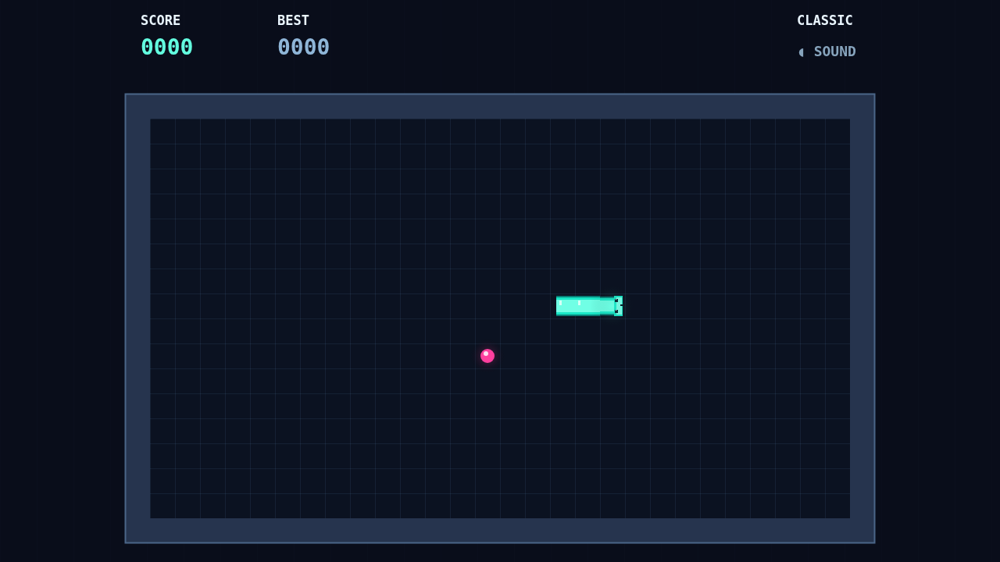

# Coil

A bright serpent winds through a dark, ruled arena. Guide it across the grid, take each glowing pellet, and keep the coil moving as the path tightens.

The snake never stops. Arrow keys or W A S D turn it at right angles, and each turn takes effect on the next beat. A wall or a collision with your own body ends the run.

Every pellet adds one cell to the tail. Eat again before the combo timer empties to raise your multiplier and score more points. Let the window fade and your multiplier returns to one.

Use Enter or Space to choose a menu item, Escape or P to pause, and M to toggle sound.

